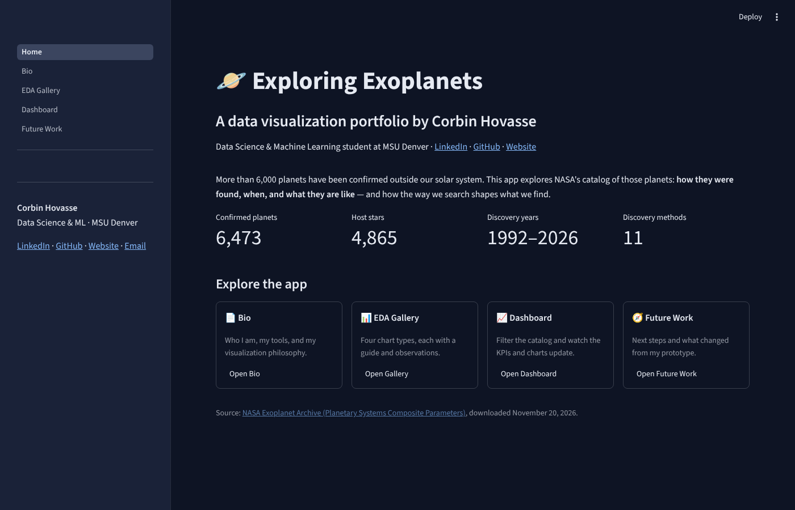
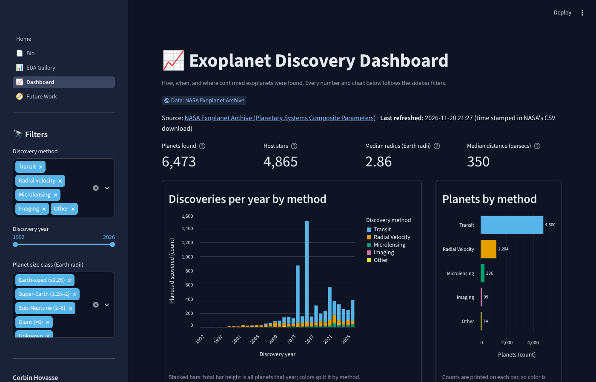

# 🪐 Exploring Exoplanets — Streamlit Data Visualization Portfolio

A multipage Streamlit app that is both my professional portfolio and a mini analytics product. It explores NASA's catalog of 6,473 confirmed exoplanets to show how, when, and by which methods planets were found, and how the way we search shapes what we find.

**Live app:** _[Exoplanet App](https://exoplanet-ch.streamlit.app/)_

## Author

**Corbin Hovasse** — B.S. Data Science & Machine Learning, MSU Denver (May 2027)
- LinkedIn: https://www.linkedin.com/in/corbin-h-923318107/
- Email: corbinhovasse@gmail.com
- Website: https://corbinhovasse-prog.github.io/

## App Navigation

| Page | What it shows |
|---|---|
| **Home** | Project overview, quick facts about the dataset, and links to each page |
| **📄 Bio** | Professional summary, highlights, and my visualization philosophy |
| **📊 EDA Gallery** | Four chart types (line, histogram, scatter, box plot), each with a question, a "How to read this chart" guide, and observations |
| **📈 Dashboard** | Sidebar filters (discovery method, year range, size class) that update four KPIs, two linked charts, a facilities table, and the data table, plus insights and limitations |
| **🧭 Future Work** | Five next steps and a reflection on what changed from my Lab 4.3 paper prototype |

## Dataset

- **Name:** NASA Exoplanet Archive — Planetary Systems Composite Parameters (PSCompPars)
- **Source:** https://exoplanetarchive.ipac.caltech.edu/cgi-bin/TblView/nph-tblView?app=ExoTbls&config=PSCompPars
- **Records:** 6,473 confirmed planets (one row per planet), downloaded November 20, 2026
- **File:** `data/exoplanets.csv`

**Preprocessing**
- Kept 12 of the 325 original columns (planet, host star, planets in system, discovery method, year, facility, orbital period, radius, mass, equilibrium temperature, star temperature, distance) to keep the file small.
- Added `pl_rade_source` ("Measured" or "Calculated") from NASA's radius reference column, because 1,544 radii are calculated from a mass–radius relationship rather than measured.
- Grouped seven rare discovery methods (74 planets) into "Other".
- Filled 6 blank facility names with "Unknown" and added a planet size class from radius ("Unknown" when radius is blank).
- No rows were removed. Charts leave out planets missing the value they plot, and each chart caption states how many planets are shown.

**Data note:** This dataset describes planets, not people, so no human-subjects ethics note is needed. Its main limitation is selection bias: each discovery method favors certain planets and stars, so counts reflect survey history and detection limits, not how common planets really are.

## Run Locally

```bash
pip install -r requirements.txt
streamlit run Home.py
```

## Requirements

See [`requirements.txt`](requirements.txt): `streamlit`, `pandas`, and `altair` with pinned versions. Requires **Python 3.11 or newer** (Streamlit 1.67 and pandas 3 need it); tested with Python 3.13. File paths are built from the app's own folder, so `streamlit run Home.py` works from any working directory.

## Project Structure

```
streamlit_app/
├─ Home.py                  # Home page
├─ utils.py                 # Shared data loading (cached), color palette, branding
├─ pages/
│  ├─ 1_📄_Bio.py
│  ├─ 2_📊_EDA_Gallery.py
│  ├─ 3_📈_Dashboard.py
│  └─ 4_🧭_Future_Work.py
├─ data/exoplanets.csv
├─ assets/banner.png        # Bio image: a one-time matplotlib plot of the dataset (period vs. radius)
├─ .streamlit/config.toml   # Dark theme
├─ requirements.txt
└─ README.md
```

## Screenshots





## AI Assistance Acknowledgment

I used Claude (Anthropic) to help generate data questions, draft code, and review the app; I checked every number against the dataset.
